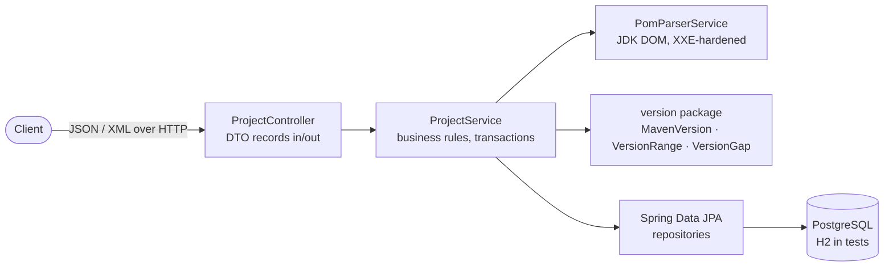

# Dependency Tracker

[](https://github.com/AVishkar23/dependency-tracker/actions/workflows/ci.yml)

A Spring Boot REST API that tracks which Maven dependencies a set of projects is
running, compares each one against the newest version its team *allows* (a policy
ceiling), and reports what has fallen behind — classified by how big the gap is,
using Maven's own version-ordering rules.

It grows out of dependency-automation work I did on a bank fraud-risk engineering
team (keeping every repository's libraries current). That tool was internal; this is
my own from-scratch rebuild of the core idea as a standalone Spring Boot service:
layered architecture, Spring Data JPA, a hardened pom parser, and a tested REST API.

## What it does

1. Register a project (`POST /api/projects`).
2. Upload its `pom.xml` (`POST /api/projects/{id}/pom`). The parser resolves
   `${property}` placeholders anywhere in a version string (including CI-friendly
   `${revision}` builds), fills versions pinned by the pom's own
   `<dependencyManagement>`, inherits versions from a declared `<parent>`, and
   records hard version ranges at the floor they resolve from. Dependencies managed
   only by an imported BOM keep a null version — the BOM's contents live in another
   artifact and are never fetched.
3. Set the newest allowed version for a dependency
   (`PATCH /api/projects/{id}/dependencies/{dependencyId}`). The ceiling must be a
   plain Maven version; ranges and malformed strings are rejected with 400.
4. Ask what's outdated (`GET /api/projects/{id}/dependencies/outdated`), or get the
   full picture from the report (`GET /api/projects/{id}/report`): counts, a
   per-severity breakdown, and every outdated dependency sorted worst-first.

Re-importing a pom replaces the dependency list but preserves previously set
ceilings, matched by groupId + artifactId.

## Version semantics

Outdated is a *semantic* comparison, not a string one. The `version` package
implements Maven's `ComparableVersion` ordering from scratch:

- Numeric segments compare numerically: `2.9.0 < 2.17.2` (lexicographic string
  order gets this backwards).
- Qualifiers rank `alpha < beta < milestone < rc < snapshot < release < sp`, with
  the usual aliases (`cr` → `rc`, `ga`/`final` → release). So `1.0-SNAPSHOT` is
  older than `1.0`, and `1.0-sp-1` is newer.
- Trailing zero/empty segments don't matter: `2.15` equals `2.15.0`.
- A dependency is outdated only when its ceiling is *strictly newer* than the
  version it runs — being ahead of the ceiling is fine. (An earlier string-based
  check flagged exactly that case; the tests now pin the correct behavior.)

Each outdated dependency is classified by the size of the jump:

| Severity   | Meaning                                              | Example            |
|------------|------------------------------------------------------|--------------------|
| `MAJOR`    | First segment differs                                | 1.9 → 2.0          |
| `MINOR`    | Second segment differs                               | 2.15.0 → 2.17.2    |
| `PATCH`    | A later numeric segment (or build suffix) differs    | 42.7.3 → 42.7.4    |
| `QUALIFIER`| Only a qualifier differs — e.g. a snapshot graduating| 1.0-SNAPSHOT → 1.0 |

Version ranges (`[1.0,2.0)`, unions, soft recommendations) are parsed by
`VersionRange`; when a pom declares a dependency with a range, the tracker records
the version Maven would resolve from — the recommended version, else the lowest
lower bound.

## Architecture



- `api/` — REST controller, DTO records, RFC 7807 error mapping, OpenAPI config.
  JPA entities never leave the service layer.
- `service/` — `ProjectService` (project/dependency rules, outdated report) and
  `PomParserService` (namespace-aware pom parsing).
- `version/` — dependency-free Maven version ordering, ranges, and gap
  classification. The part with the most tests, because it's the part that's
  easiest to get subtly wrong.
- `model/`, `repository/` — JPA entities and derived-query repositories.

Interactive API docs: Swagger UI at `/swagger-ui.html`, raw spec at `/v3/api-docs`
(generated by springdoc from the controller).

## Run it

```bash
docker compose up --build
# app on http://localhost:8080, PostgreSQL on localhost:5432
```

Or without Docker (needs a local PostgreSQL, or edit `application.properties`):

```bash
mvn spring-boot:run
```

## Try it

```bash
# create a project
curl -X POST localhost:8080/api/projects -H 'Content-Type: application/json' \
  -d '{"name":"payments-service","repoUrl":"https://github.com/example/payments"}'

# import its pom.xml
curl -X POST localhost:8080/api/projects/1/pom -H 'Content-Type: application/xml' \
  --data-binary @pom.xml

# set the newest allowed version for dependency 1
curl -X PATCH localhost:8080/api/projects/1/dependencies/1 -H 'Content-Type: application/json' \
  -d '{"latestAllowedVersion":"2.17.2"}'

# see what's outdated
curl localhost:8080/api/projects/1/dependencies/outdated

# or the classified report
curl localhost:8080/api/projects/1/report
```

```json
{
  "projectId": 1,
  "projectName": "payments-service",
  "generatedAt": "2026-11-03T07:20:00Z",
  "totalDependencies": 4,
  "outdatedCount": 3,
  "bySeverity": { "MINOR": 1, "PATCH": 1, "QUALIFIER": 1 },
  "outdated": [
    { "dependencyId": 1, "groupId": "com.fasterxml.jackson.core",
      "artifactId": "jackson-databind", "currentVersion": "2.15.0",
      "latestAllowedVersion": "2.17.2", "severity": "MINOR" },
    { "dependencyId": 2, "groupId": "org.postgresql",
      "artifactId": "postgresql", "currentVersion": "42.7.3",
      "latestAllowedVersion": "42.7.4", "severity": "PATCH" },
    { "dependencyId": 3, "groupId": "com.example",
      "artifactId": "lib", "currentVersion": "1.0-SNAPSHOT",
      "latestAllowedVersion": "1.0", "severity": "QUALIFIER" }
  ]
}
```

## Tests

```bash
mvn test
```

47 tests, all run in CI on every push:

- **Version ordering (27)** — canonical ordering chains, qualifier ranks and
  aliases, numeric-vs-string traps, range parsing/containment, gap classification.
- **Pom parsing (14)** — namespaces, dependencyManagement pins, imported BOMs,
  parent inheritance, nested/inline interpolation, duplicates, ranges, XXE and
  non-pom rejection.
- **End-to-end flow (5)** — create → import → set ceiling → outdated/report over
  MockMvc against H2, including the semantic-outdated regressions and ceiling
  validation.
- **OpenAPI (1)** — the generated spec names the service and lists the key paths.

## Design decisions & limitations

- **Policy ceiling, not "latest on Maven Central."** Deliberate: the newest
  published version is not always safe to adopt, so the tracker compares against
  what a team has decided to allow. Looking up Central's latest per artifact is
  the documented next step, not a missing feature.
- **Parser safety:** the DOM factory disallows DOCTYPE entirely — a pom.xml is
  untrusted input, and this blocks XXE / billion-laughs attacks.
- **Parser scope, honestly:** `<dependencyManagement>` is honored only within the
  same pom. Imported BOMs and parent-POM dependencyManagement are *not* resolved —
  that would mean fetching and recursively merging other artifacts, which is
  Maven's job, not a tracker's. Dependencies inside `<profiles>` are ignored, and
  a duplicated dependency resolves last-declaration-wins, as in Maven.
- **Outdated filtering happens in memory** after loading a project's dependencies.
  A project's list is small (hundreds at most); at org scale the comparison belongs
  in a query — but Maven version ordering doesn't exist in SQL, which is exactly
  why the comparison lives in a small, heavily tested Java package.
- **Versions are compared, never parsed into floats or split naively.** All
  ordering goes through the one `MavenVersion` implementation.

## Tech

- Java 17, Spring Boot 3.3 (Web, Data JPA), springdoc-openapi 2.6
- PostgreSQL 16 in Docker; H2 for tests
- JUnit 5 + MockMvc + AssertJ
- Multi-stage Dockerfile; `docker-compose.yml` runs the app + PostgreSQL together
- GitHub Actions CI on every push (`.github/workflows/ci.yml`)
